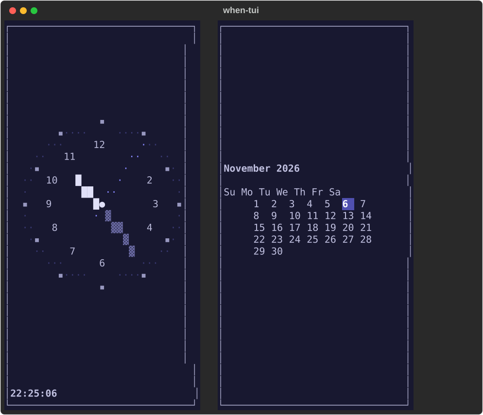

# when-tui

A terminal replica of the **Nintendo DS "standby" menu screen** — an analog clock
and a month calendar side by side, drawn entirely out of box-drawing characters.



The palette follows the time of day: `morning` → `afternoon` → `evening` → `night`.

## Requirements

- Python **3.10+** (the code uses `datetime | None` annotations)
- [`textual`](https://textual.textualize.io/) + `rich` — see `requirements.txt`

## Install & run

```bash
git clone https://github.com/navioski/when-tui.git
cd when-tui

# with uv (recommended — it builds the venv for you)
uv run when.py

# or plain pip
python3 -m venv .venv
.venv/bin/pip install -r requirements.txt
.venv/bin/python when.py
```

## Keys

| Key | Action |
|---|---|
| <kbd>←</kbd> / <kbd>→</kbd> | previous / next month |
| <kbd>t</kbd> | jump back to today |
| <kbd>q</kbd> | quit |

## How it works

- Single file (`when.py`, ~500 lines) — no assets, no fonts.
- The clock and calendar are plain `rich.text.Text` objects assembled cell by
  cell; colours are applied as background styles on spaces, which is why the
  whole screen is just text.
- The clock refreshes once a second via `set_interval(1.0)`.

## Verified

Tested on **Python 3.14.5 + textual 8.2.8 + rich 15.0.0** (macOS, 2026-11).

## License

MIT — see [LICENSE](LICENSE).
