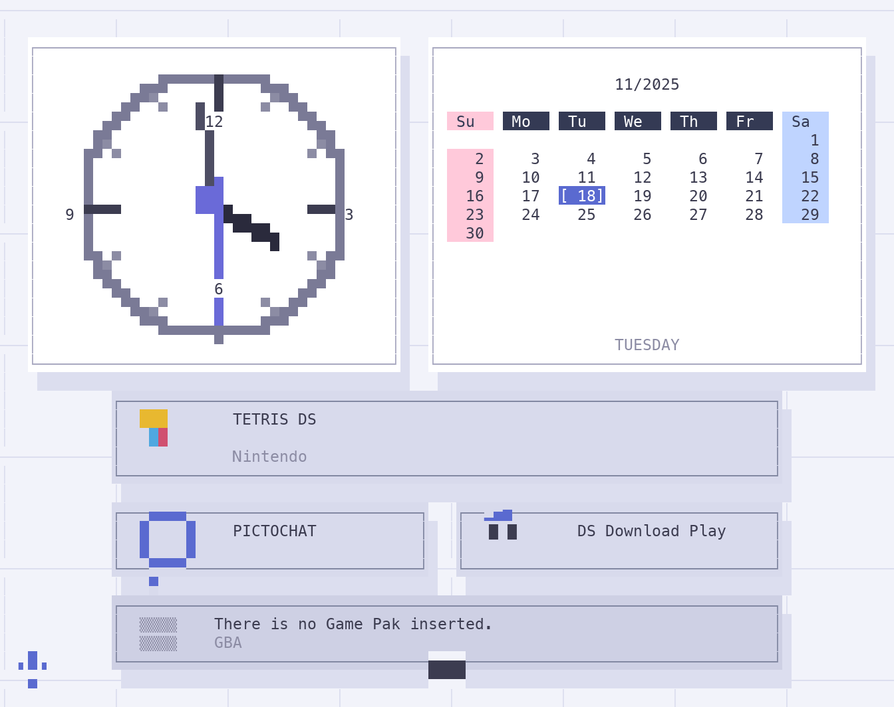

# when-tui

A terminal replica of the **Nintendo DS menu screen**: grid-paper background, an
analog clock, a month calendar with coloured weekend columns, the app tiles and
the empty GBA slot — drawn cell by cell with [Textual](https://textual.textualize.io/).



The palette follows the time of day (`morning` → `afternoon` → `evening` → `night`),
the way the DS tints its own menu.

## Requirements

- Python **3.10+**
- [`textual`](https://textual.textualize.io/) (pinned in `requirements.txt`)
- A terminal of at least **96 × 38** cells

## Install & run

```bash
git clone https://github.com/navioski/when-tui.git
cd when-tui

# with uv (recommended — creates the venv for you)
uv run when.py

# or plain pip
python3 -m venv .venv
.venv/bin/pip install -r requirements.txt
./when.py
```

`when.py` is executable and re-executes itself through `./.venv/bin/python` when
that venv exists, so `./when.py` is enough once the venv is set up. Without a
venv it prints the three commands above instead of a traceback.

## Keys

| Key | Action |
|---|---|
| <kbd>←</kbd> / <kbd>→</kbd> | previous / next month |
| <kbd>t</kbd> | jump back to today |
| <kbd>q</kbd> | quit |

## What's on screen

- **Grid paper** — the DS menu's ruled background, redrawn every frame.
- **Clock** — a round pixel-art face with 60 rim ticks, hour/minute/second hands
  and 12/3/6/9 numerals.
- **Calendar** — `MM/YYYY`, a weekday header bar, Sundays on pink and Saturdays on
  blue, and today bracketed in the accent colour (the weekday is spelled out
  underneath).
- **Tiles** — `TETRIS DS`, `PICTOCHAT`, `DS Download Play`, with small hand-drawn
  icons instead of font glyphs.
- **GBA slot** — "There is no Game Pak inserted.", like the real thing.

## How it's drawn

Two layers do all the work:

1. A `Canvas` of `(char, fg, bg)` cells — one character per cell, colours carried
   by the style. Boxes, cards, the calendar grid and all text live here.
2. A `PixelCanvas` for the clock face: each pixel is half a cell tall, so a cell
   is rendered as `▀` with the top pixel as the foreground colour and the bottom
   pixel as the background colour. That doubles the vertical resolution and is
   what makes the face look round instead of stepped.

No images, no fonts, no assets — everything is characters and colour.

## Verified

Tested on **Python 3.14.5 + textual 8.2.8** (macOS, 2026-11), rendered as a 96 × 38
canvas.
